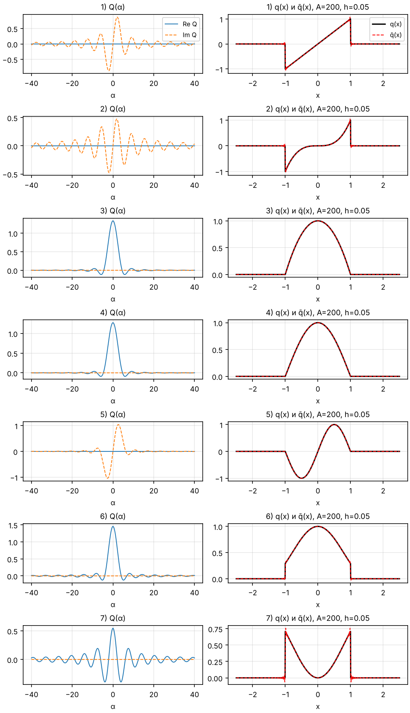
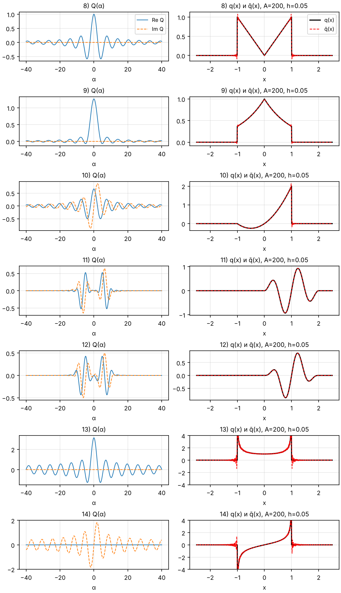
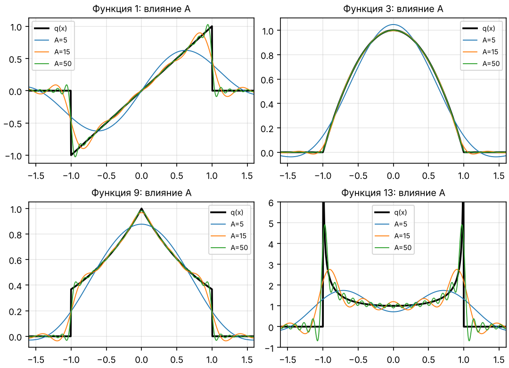
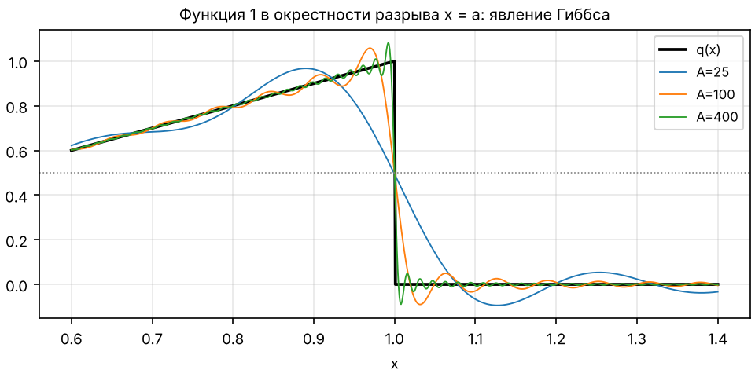
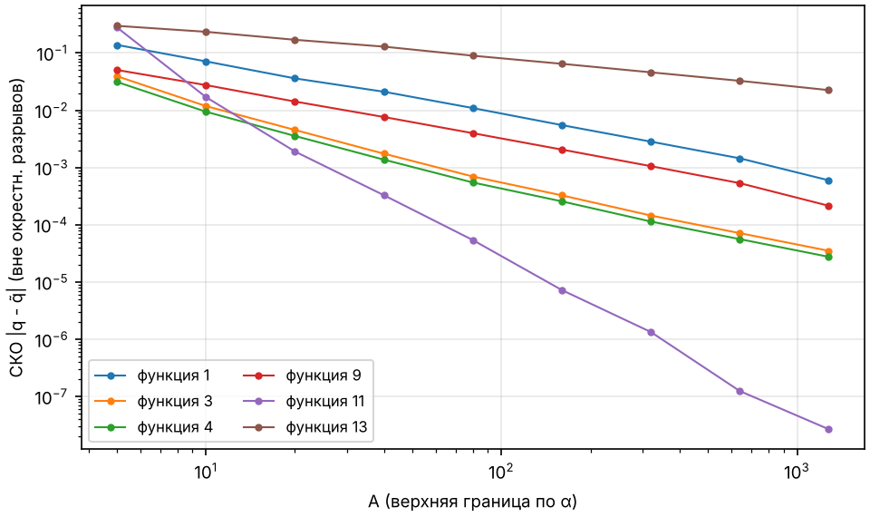
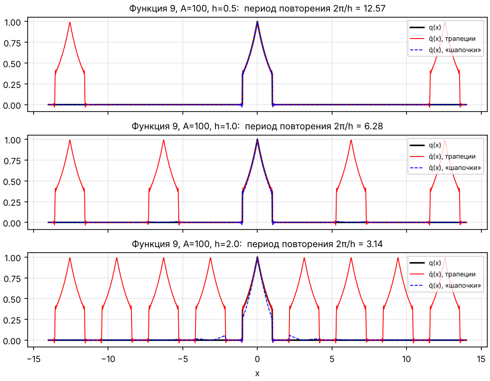
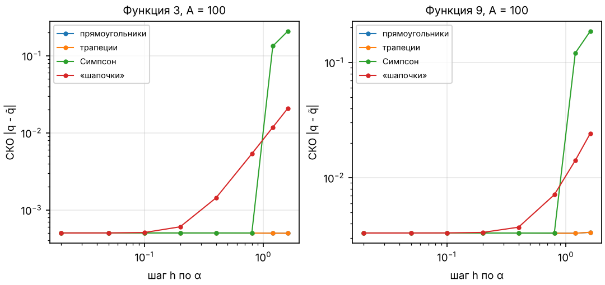

<!-- title: Аналитическое вычисление преобразования Фурье и его численное обращение -->

# 1. Постановка задачи

Для функций 1)–14) требуется:

1. найти преобразование Фурье
$$Q(\alpha)=\int\limits_{-\infty}^{+\infty} q(x)\,e^{i\alpha x}\,dx \qquad (1)$$
аналитически, используя известные приёмы вычисления определённых интегралов;
2. написать программу, реализующую численное обращение преобразования Фурье
$$\tilde q(x)=\frac{1}{2\pi}\int\limits_{-\infty}^{+\infty} Q(\alpha)\,e^{-i\alpha x}\,d\alpha \qquad (2)$$
для полученных функций и сравнить численное решение $\tilde q(x)$ с исходной функцией $q(x)$;
3. проанализировать влияние особенностей программной реализации интеграла (2) на результат.

Исходные функции (в заданиях 1–10 $a>0$ — произвольная постоянная; везде $q(x)=0$ вне указанного промежутка):

| № | $q(x)$ | промежуток | № | $q(x)$ | промежуток |
|:----:|:----------:|:--------:|:----:|:--------------------:|:--------:|
| 1 | $x/a$ | \|x\| ≤ a | 8 | \|x\|/a | \|x\| ≤ a |
| 2 | $a x^3$ | \|x\| ≤ a | 9 | e^−\|x\|^ | \|x\| ≤ a |
| 3 | $1-x^2/a^2$ | \|x\| ≤ a | 10 | $x+x^2$ | \|x\| ≤ a |
| 4 | $\cos\frac{\pi x}{2a}$ | \|x\| ≤ a | 11 | $\sin 2\pi x\cdot\sin\frac{\pi x}{2}$ | 0 < x < 2 |
| 5 | $\sin\frac{\pi x}{a}$ | \|x\| ≤ a | 12 | $\frac12\sin 2\pi x\,(1-\cos\pi x)$ | 0 < x < 2 |
| 6 | $\cos^2\frac{x}{a}$ | \|x\| ≤ a | 13 | $1/\sqrt{1-x^2}$ | \|x\| < 1 |
| 7 | $\sin^2\frac{x}{a}$ | \|x\| ≤ a | 14 | $x/\sqrt{1-x^2}$ | \|x\| < 1 |

# 2. Найденный вид функций Q(α)

Все функции финитны, поэтому интеграл (1) берётся по конечному промежутку. Для чётных функций на $[-a,a]$
$Q(\alpha)=2\int_0^a q(x)\cos\alpha x\,dx$ (вещественная чётная функция), для нечётных —
$Q(\alpha)=2i\int_0^a q(x)\sin\alpha x\,dx$ (чисто мнимая нечётная функция). Интегралы от
многочленов, умноженных на $\cos\alpha x$, $\sin\alpha x$, вычислены интегрированием по частям,
произведения тригонометрических функций сведены к суммам, интегралы 13), 14) сведены к
интегральному представлению функций Бесселя $J_0(\alpha)=\frac1\pi\int_{-1}^{1}\frac{\cos\alpha x}{\sqrt{1-x^2}}dx$
и $J_0'(\alpha)=-J_1(\alpha)$. Обозначим $G(\gamma)=\int_0^2 e^{i\gamma x}dx=\dfrac{e^{2i\gamma}-1}{i\gamma}=2e^{i\gamma}\dfrac{\sin\gamma}{\gamma}$,
$C(\alpha,c)=\int_{-a}^{a}\cos cx\, e^{i\alpha x}dx=\dfrac{\sin(\alpha-c)a}{\alpha-c}+\dfrac{\sin(\alpha+c)a}{\alpha+c}$.

1) $Q(\alpha)=\dfrac{2i}{a\alpha^2}\left(\sin\alpha a-\alpha a\cos\alpha a\right)$

2) $Q(\alpha)=2ia\left[\left(\dfrac{3a^2}{\alpha^2}-\dfrac{6}{\alpha^4}\right)\sin\alpha a+\left(\dfrac{6a}{\alpha^3}-\dfrac{a^3}{\alpha}\right)\cos\alpha a\right]$

3) $Q(\alpha)=\dfrac{4}{a^2\alpha^3}\left(\sin\alpha a-\alpha a\cos\alpha a\right)$

4) $Q(\alpha)=\dfrac{4\pi a\cos\alpha a}{\pi^2-4a^2\alpha^2}$

5) $Q(\alpha)=\dfrac{2\pi i a\sin\alpha a}{\pi^2-a^2\alpha^2}$

6) $Q(\alpha)=\dfrac{\sin\alpha a}{\alpha}+\dfrac12\,C\!\left(\alpha,\tfrac{2}{a}\right)$ (так как $\cos^2\frac xa=\frac12+\frac12\cos\frac{2x}{a}$)

7) $Q(\alpha)=\dfrac{\sin\alpha a}{\alpha}-\dfrac12\,C\!\left(\alpha,\tfrac{2}{a}\right)$

8) $Q(\alpha)=\dfrac{2\sin\alpha a}{\alpha}+\dfrac{2(\cos\alpha a-1)}{a\alpha^2}$

9) $Q(\alpha)=\dfrac{2\left[1-e^{-a}\left(\cos\alpha a-\alpha\sin\alpha a\right)\right]}{1+\alpha^2}$

10) $Q(\alpha)=\dfrac{2i\left(\sin\alpha a-\alpha a\cos\alpha a\right)}{\alpha^2}+2\left(\dfrac{a^2\sin\alpha a}{\alpha}+\dfrac{2a\cos\alpha a}{\alpha^2}-\dfrac{2\sin\alpha a}{\alpha^3}\right)$

11) $q=\frac12\left[\cos\frac{3\pi x}{2}-\cos\frac{5\pi x}{2}\right]$, $\;Q(\alpha)=\dfrac14\left[G\!\left(\alpha+\tfrac{3\pi}{2}\right)+G\!\left(\alpha-\tfrac{3\pi}{2}\right)-G\!\left(\alpha+\tfrac{5\pi}{2}\right)-G\!\left(\alpha-\tfrac{5\pi}{2}\right)\right]$

12) $q=\frac12\sin 2\pi x-\frac14\sin 3\pi x-\frac14\sin\pi x$, $\;Q(\alpha)=\dfrac12S(2\pi)-\dfrac14S(3\pi)-\dfrac14S(\pi)$, где $S(\beta)=\dfrac{G(\alpha+\beta)-G(\alpha-\beta)}{2i}$

13) $Q(\alpha)=\pi J_0(\alpha)$

14) $Q(\alpha)=i\pi J_1(\alpha)$

В точках $\alpha=0$ (1–3, 8, 10) и $\alpha=\pm\frac{\pi}{2a}$ (4), $\alpha=\pm\frac{\pi}{a}$ (5) формулы содержат
устранимые особенности вида $0/0$; например, $Q_1(0)=0$, $Q_3(0)=\frac{4a}{3}$, $Q_4(\pm\frac{\pi}{2a})=a$, $Q_8(0)=a$.
В программе значения в малой окрестности ($|\alpha-\alpha^*|<10^{-2}$) таких точек вычисляются квадратурой.

**Проверка формул.** Каждая формула сравнивалась с прямым численным интегрированием (1) квадратурой
Гаусса–Лежандра (800 узлов; для 13), 14) — после замены $x=\sin\theta$, снимающей особенность на концах)
на сетке $\alpha\in[-60,60]$ при $a=0{,}5;\,1;\,2$. Максимальные расхождения приведены во втором столбце
таблицы 2 — они находятся на уровне ошибок округления ($10^{-16}\ldots10^{-13}$; для 2) — $10^{-10}$
из-за вычитания близких слагаемых $\sim\alpha^{-4}$ при малых $\alpha$), т.е. все формулы верны.

{{code:lab0/lab0.py:Q_exact}}

# 3. Особенности программной реализации вычисления интеграла (2)

Программа написана на Python (NumPy, SciPy, Matplotlib), файл `lab0/lab0.py`.

Интеграл (2) по бесконечному промежутку заменяется интегралом по $[-A,A]$, который вычисляется на
равномерной сетке $\alpha_k=-A+kh$, $k=0..n$, $h=2A/n$:
$$\tilde q(x)\approx\frac{1}{2\pi}\sum_{k=0}^{n} w_k\,Q(\alpha_k)\,e^{-i\alpha_k x}.$$
Реализованы четыре квадратурные формулы (веса $w_k$):

* левых прямоугольников: $w_k=h$, $w_n=0$;
* трапеций: $w_k=h$, $w_0=w_n=h/2$;
* Симпсона: $w_k=\frac h3\{1,4,2,4,\dots,2,4,1\}$;
* «сплайн-шапочек» (аналог подхода из теоретической части ЛР1, метод Филона): $Q(\alpha)$ заменяется
  кусочно-линейным интерполянтом $\sum_k Q_k\varphi_k(\alpha)$, а интегралы от «шапочек» с экспонентой
  вычисляются точно: $\int\varphi_k(\alpha)e^{-i\alpha x}d\alpha=h\,e^{-i\alpha_k x}\left[\dfrac{\sin(xh/2)}{xh/2}\right]^2$
  для внутренних узлов и $\dfrac{e^{uh}-1-uh}{u^2h}$, $u=\mp ix$ — для половинных «шапочек» на концах.

Суммирование выполняется векторно (матрица $e^{-i\alpha_k x_j}$ формируется блоками по 2000 точек $x$).
Так как $q(x)$ вещественна, мнимая часть результата (ошибка округления) отбрасывается.

{{code:lab0/lab0.py:quad_weights}}

{{code:lab0/lab0.py:inverse_ft}}

{{code:lab0/lab0.py:half_hat}}

# 4. Результаты сопоставления q(x) и q̃(x)

На рисунках 1, 2 показаны найденные $Q(\alpha)$ (вещественная и мнимая части) и результат численного
обращения $\tilde q(x)$ (метод трапеций, $A={{res.A0}}$, $h={{res.h0}}$, $a={{res.a}}$) в сравнении с $q(x)$.
Для всех 14 функций $\tilde q(x)$ практически совпадает с $q(x)$; заметные отличия есть только в малых
окрестностях точек разрыва $q(x)$ (осцилляции) и у особенностей функций 13), 14).

{width=16.5cm}

{width=16.5cm}

В таблице 2 приведены максимальная и среднеквадратичная (СКО) ошибки $|q-\tilde q|$ на сетке
$x\in[-2{,}5;\,2{,}5]$ (1001 точка) вне $0{,}05$-окрестностей точек разрыва (для 13), 14) — вне
$0{,}1$-окрестностей $x=\pm1$) для трёх значений верхней границы $A$ (метод трапеций, $h={{res.h0}}$).

Таблица 2 – Ошибки вычисления Q(α) по формулам и ошибки численного обращения

{{res.md_table_err}}

# 5. Анализ влияния особенностей программной реализации

**5.1. Верхняя граница $A$ (усечение интеграла).** Усечение интеграла (2) эквивалентно умножению $Q(\alpha)$
на прямоугольное окно, т.е. свёртке $q(x)$ с ядром $\frac{\sin Ax}{\pi x}$. Поэтому $\tilde q(x)$ —
«сглаженная» $q(x)$ (рисунок 3): при малых $A$ теряются мелкие детали, в окрестностях разрывов
возникают осцилляции, а в самой точке разрыва $\tilde q$ стремится к полусумме односторонних пределов.
С ростом $A$ осцилляции сжимаются к точке разрыва, но их амплитуда не убывает — явление Гиббса
(рисунок 4): выброс у разрыва функции 1) при $A=100$ и $A=400$ равен
{{res.gibbs.100:.3f}} и {{res.gibbs.400:.3f}} величины скачка (теоретический предел ≈ 0,0895).

{width=16cm}

{width=13cm}

Скорость сходимости $\tilde q\to q$ при $A\to\infty$ определяется скоростью убывания $|Q(\alpha)|$,
т.е. гладкостью $q(x)$ (рисунок 5, наклоны прямых в логарифмическом масштабе по последним точкам):

* разрывные функции (1, 2, 6–10): $Q=O(\alpha^{-1})$, СКО вне окрестностей разрывов $\sim A^{ {{res.slopes.1:.2f}} }$;
* непрерывные функции с изломом (3–5): $Q=O(\alpha^{-2})$, вдали от изломов ошибка убывает как $A^{-2}$,
  а вблизи изломов — как $A^{-1}$, поэтому суммарное СКО $\sim A^{ {{res.slopes.3:.2f}} }$;
* функции 11), 12) непрерывны вместе с первой производной ($Q=O(\alpha^{-3})$): СКО $\sim A^{ {{res.slopes.11:.2f}} }$,
  уже при $A=100$ ошибка ~$10^{-5}$;
* функции 13), 14) неограниченны: $Q\sim\alpha^{-1/2}$ (асимптотика функций Бесселя), сходимость самая
  медленная — СКО $\sim A^{ {{res.slopes.13:.2f}} }$.

{width=13cm}

**5.2. Шаг $h$ по $\alpha$.** Замена интеграла суммой по равномерной сетке с шагом $h$ приводит
(формула суммирования Пуассона) к периодизации результата:
$\tilde q_h(x)=\sum_m \tilde q\!\left(x+\frac{2\pi m}{h}\right)$, т.е. восстановленная функция
повторяется с периодом $2\pi/h$ (рисунок 6). Пока период больше удвоенного размера носителя и
рассматриваемой области $x$, копии не мешают, и для финитных $q(x)$ метод трапеций при этом **не зависит
от $h$** (ошибка определяется только $A$, см. рисунок 7). При $2\pi/h$ меньше ширины области
копии накладываются (наложение, aliasing) — результат неверен. Отсюда условие выбора шага:
$h<\pi/X$, где $[-X,X]$ — интересующий диапазон $x$.

{width=16cm}

**5.3. Квадратурная формула.** Рисунок 7 показывает СКО для четырёх методов при $A=100$:

* прямоугольники и трапеции дают практически одинаковый результат (отличие — только вклад концевых
  точек, где $Q(\pm A)$ мало);
* метод Симпсона эквивалентен комбинации сумм с шагами $h$ и $2h$, поэтому у него появляются
  дополнительные «копии» с периодом $\pi/h$ — он ломается при вдвое меньших $h$, чем трапеции, и
  не даёт выигрыша в точности, поскольку подынтегральная функция осциллирует, а ошибка определяется усечением;
* метод «шапочек» умножает слагаемые на множитель $\left[\frac{\sin(xh/2)}{xh/2}\right]^2\approx1-\frac{x^2h^2}{12}$,
  т.е. вносит систематическое затухание при больших $x h$ (ошибка растёт как $h^2$), но зато
  подавляет периодические копии (рисунок 6, синяя линия): при грубом шаге он даёт «чистый» результат
  вне основного носителя.

{width=16cm}

# 6. Выводы

1. Найдены аналитические выражения $Q(\alpha)$ для всех 14 функций; их правильность подтверждена
   численным интегрированием (расхождение на уровне ошибок округления).
2. Численное обращение (2) восстанавливает исходные функции; точность определяется в первую очередь
   верхней границей $A$ и скоростью убывания $Q(\alpha)$, т.е. гладкостью $q(x)$: от $A^{-0,5}$
   (функции с особенностями 13, 14) до $A^{-2,8}$ (гладкие функции 11, 12).
3. У разрывов наблюдается явление Гиббса (выброс ≈ 9 % скачка, не исчезающий при росте $A$).
4. Шаг $h$ должен удовлетворять условию $2\pi/h>2X$, иначе возникают периодические копии;
   при выполнении этого условия для финитных функций уменьшение $h$ не повышает точность.
5. Метод трапеций оказался оптимальным; метод Симпсона чувствительнее к шагу, а метод «шапочек»
   вносит затухание $\sim(xh)^2$, но подавляет копии.

Программа: `lab0/lab0.py` (запуск `python lab0/lab0.py --a 1`, параметр $a$ можно менять).
