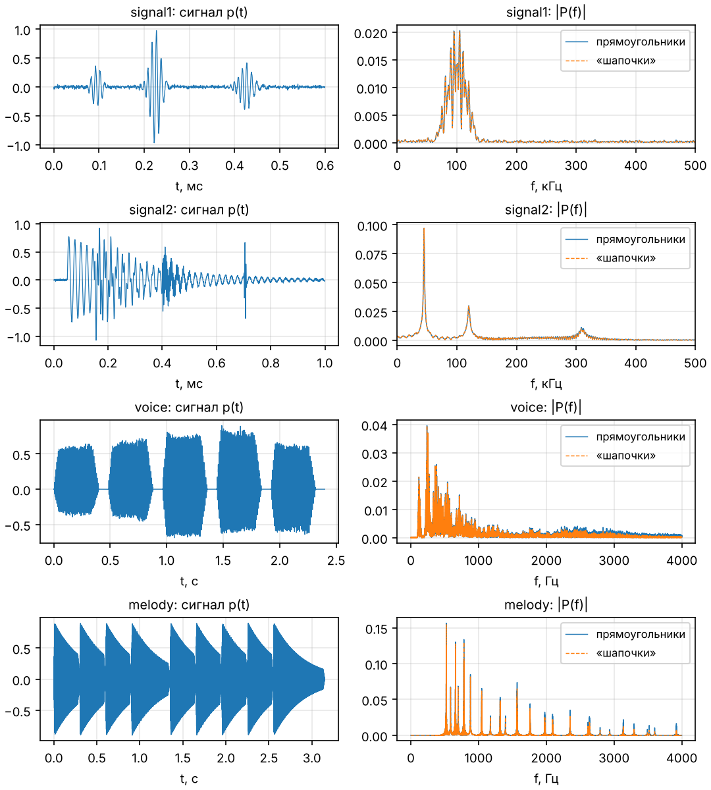
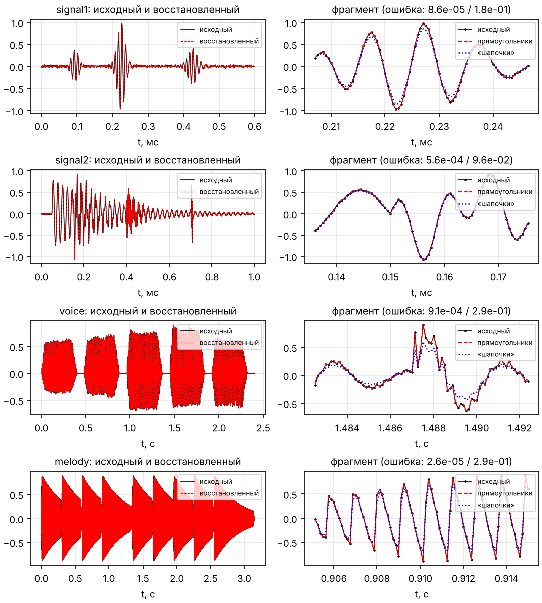
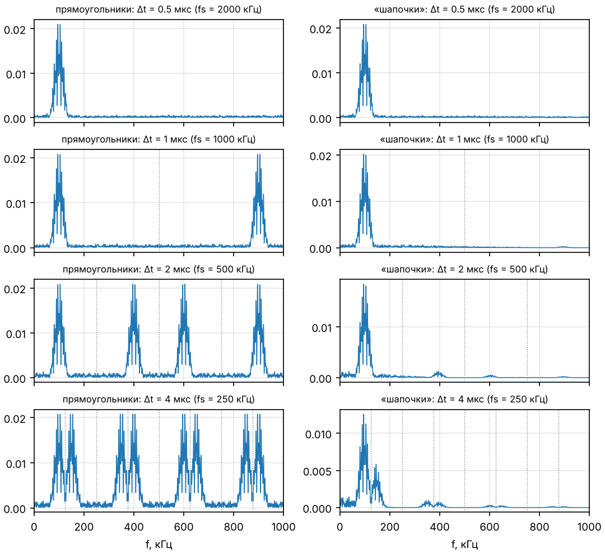
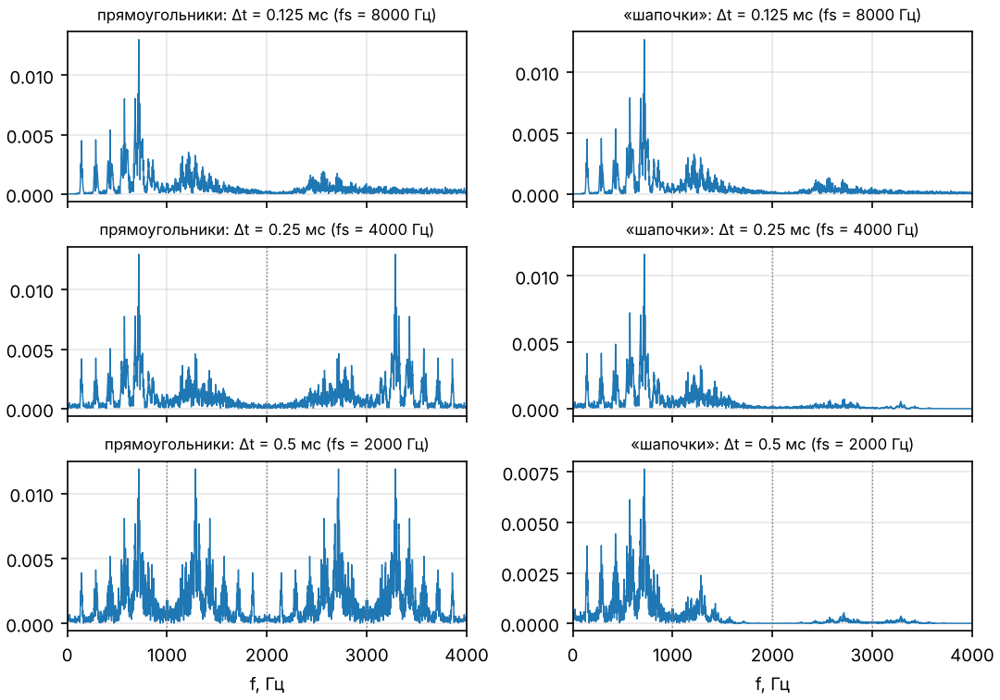
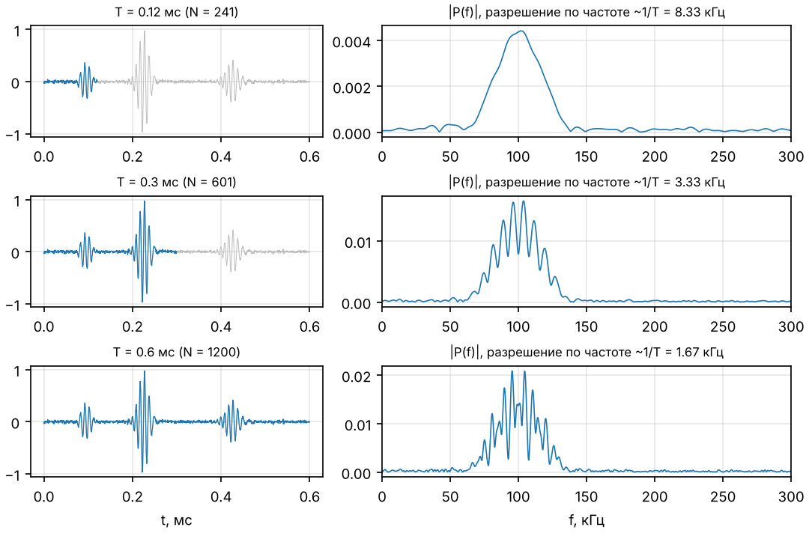
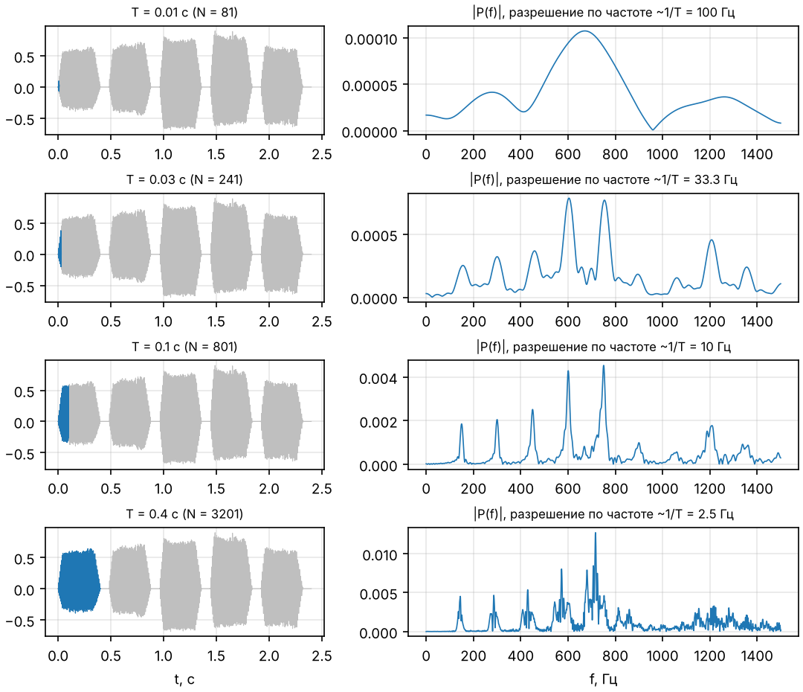
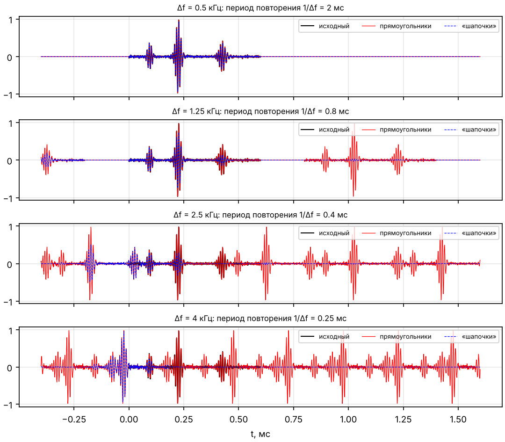
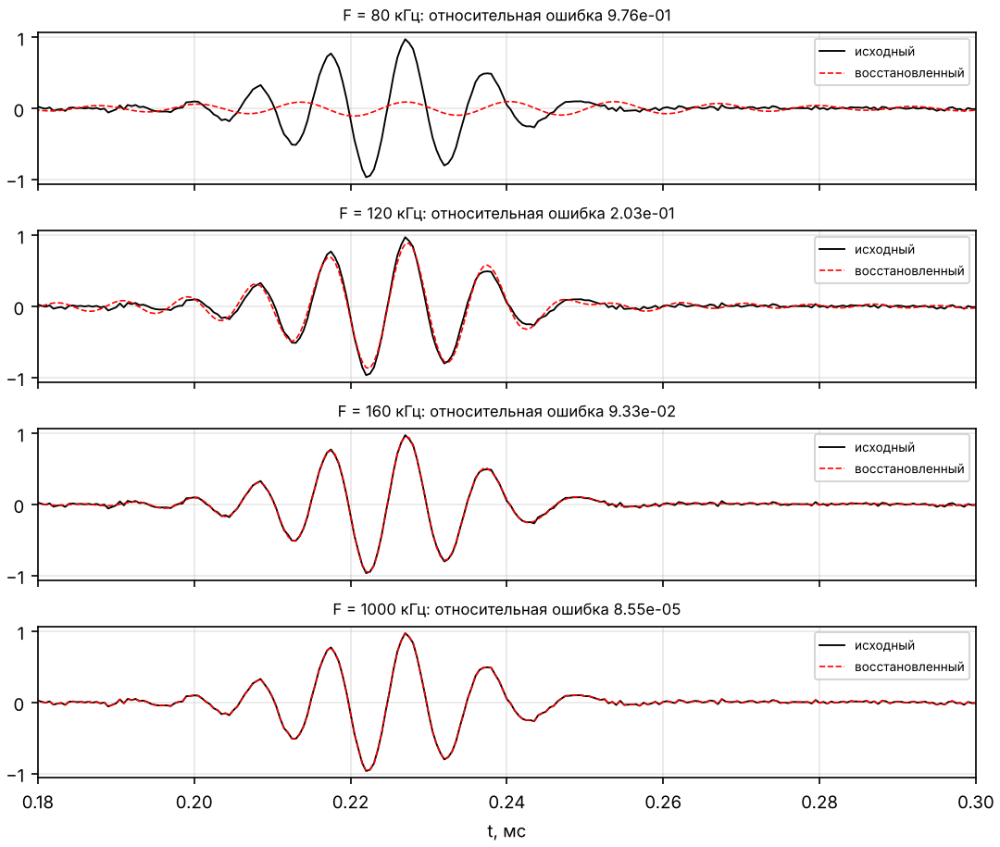
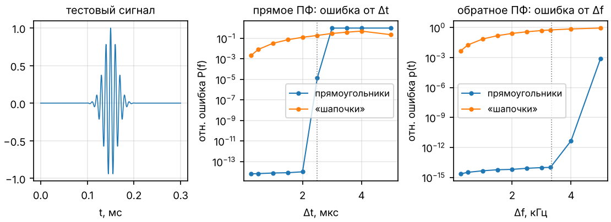

<!-- title: Прямое и обратное преобразование Фурье -->

# 1. Постановка задачи

Реализовать вычисление прямого и обратного преобразования Фурье, визуализировать получаемые
результаты, проанализировать влияние входных параметров на особенности получаемого спектра и вид
восстановленного по нему сигнала.

Параметры для анализа: шаг дискретизации во временной ($\Delta t$) и частотной ($\Delta f$) областях;
верхний диапазон значений времени $T$ (для прямого ПФ) и частоты $F$ (для обратного ПФ);
алгоритм вычисления прямого и обратного ПФ.

**Входные данные.** Архив «Signals.zip» в предоставленных материалах отсутствует, поэтому использованы
четыре сигнала (файлы в папке `data/`, генератор — `data/make_data.py`; программа принимает любые
файлы того же формата, в т.ч. собственные записи голоса в .wav):

* `signal1.txt` — модельная запись датчика при распространении упругих волн Лэмба в пластине
  (зондирующий импульс — 5 периодов синусоиды 100 кГц с окном Ханна; пакеты мод $S_0$, $A_0$
  (с дисперсией) и отражение от края; шум), $\Delta t=0{,}5$ мкс, $N=1200$, время в мс;
* `signal2.txt` — отклик на ударное воздействие (затухающие колебания 45, 120 и 310 кГц, включающиеся
  в разные моменты, и короткий импульс 250 кГц), $\Delta t=0{,}5$ мкс, $N=2000$;
* `voice.wav` — синтезированный голос (гласные «а-о-у-и-э», формантный синтез, основной тон 110–150 Гц),
  8 кГц, 2,4 с;
* `melody.wav` — синтезированная мелодия (9 нот с обертонами), 8 кГц, 3,15 с.

Для текстовых сигналов время измеряется в миллисекундах, поэтому частота — в килогерцах
(как в теоретической части), для аудиосигналов — в секундах и герцах.

# 2. Алгоритм решения

Спектр сигнала, заданного отсчётами $p_j=p(t_j)$, $t_j=t_1+(j-1)\Delta t$, $j=1..N$:
$$P(\omega)=\int_{-\infty}^{\infty}p(t)e^{-i\omega t}dt,\qquad \omega=2\pi f.$$
Реализованы два алгоритма прямого ПФ:

1. **формула прямоугольников:** $P(\omega)\approx\Delta t\sum_{j=1}^{N}p_je^{-i\omega t_j}$
   (в формуле (2) теоретической части множитель $\Delta t$ опущен; он нужен для правильного масштаба
   спектра и согласования с обратным ПФ);
2. **аппроксимация сплайнами первого порядка («шапочками»)** $p(t)\approx\sum_j p_j\varphi_j(t)$:
   $$P_1(\omega)=\sum_{j=1}^{N}p_j\Phi_j(\omega),\quad
   \Phi_j(\omega)=\int_{t_j-\Delta t}^{t_j+\Delta t}\varphi_j(t)e^{-i\omega t}dt=
   \Delta t\,e^{-i\omega t_j}\left[\frac{\sin(\omega\Delta t/2)}{\omega\Delta t/2}\right]^2.$$
   Интеграл $\Phi_j$ вычислен аналитически (преобразование Фурье треугольного импульса), поэтому
   $P_1(\omega)$ отличается от формулы прямоугольников множителем $\mathrm{sinc}^2(\omega\Delta t/2)$.

Обратное ПФ по спектру, заданному на сетке $\omega_i=i\Delta\omega\in[0,\Omega]$, $\Omega=2\pi F$:
$$p_1(t)=\frac1\pi\mathrm{Re}\int_0^\Omega P_1(\omega)e^{i\omega t}d\omega,$$
также двумя способами — прямоугольниками $p_1(t)\approx\frac{\Delta\omega}{\pi}\mathrm{Re}\sum_i w_iP_{1,i}e^{i\omega_it}$
и «шапочками» по частоте, для которых $\Psi_i(t)=\int\psi_i(\omega)e^{i\omega t}d\omega=\Delta\omega\,e^{i\omega_it}\,\mathrm{sinc}^2(t\Delta\omega/2)$.
Узел $\omega_0=0$ берётся с весом $w_0=1/2$ (на отрезке $[0,\Omega]$ лежит половина «шапочки» с центром в нуле).

Все суммы вычисляются векторно (матрица экспонент $e^{-i\omega t_j}$ размера $M\times N$ формируется
блоками по $4\cdot10^6$ элементов), сложность $O(NM)$. По умолчанию $F=f_s/2$ (частота Найквиста),
$\Delta f=1/(2T)$.

Выдержки из программного кода (модуль `common/ctft.py`):

{{code:common/ctft.py:forward_ft}}

{{code:common/ctft.py:inverse_ft}}

Основная программа `lab1/lab1.py` содержит функции экспериментов; пример — исследование шага по времени:

{{code:lab1/lab1.py:exp_dt}}

# 3. Результаты

## 3.1. Сигналы, их спектры и восстановленные сигналы

На рисунке 1 приведены сигналы и модули их спектров, вычисленные обоими алгоритмами. У `signal1`
спектр сосредоточен около 100 кГц (частота зондирующего импульса), «изрезанность» спектра —
результат интерференции трёх волновых пакетов, разнесённых во времени. У `signal2` видны
резонансные пики 45, 120 и 310 кГц, ширина которых обратно пропорциональна времени затухания.
У голоса — гармоники основного тона и форманты, у мелодии — набор частот нот и их обертонов.

{width=16.5cm}

На рисунке 2 сигналы, восстановленные по спектру (прямое и обратное ПФ одним и тем же алгоритмом,
$F=f_s/2$, $\Delta f=1/(2T)$), совмещены с исходными. Относительные ошибки
$\|p_1-p\|/\|p\|$:

| сигнал | N | M (частот) | прямоугольники | «шапочки» |
|:-:|:-:|:-:|:-:|:-:|
| signal1 | {{res.overview.signal1.N}} | {{res.overview.signal1.M}} | {{res.overview.signal1.err_rect:.1e}} | {{res.overview.signal1.err_spline:.2f}} |
| signal2 | {{res.overview.signal2.N}} | {{res.overview.signal2.M}} | {{res.overview.signal2.err_rect:.1e}} | {{res.overview.signal2.err_spline:.2f}} |
| voice | {{res.overview.voice.N}} | {{res.overview.voice.M}} | {{res.overview.voice.err_rect:.1e}} | {{res.overview.voice.err_spline:.2f}} |
| melody | {{res.overview.melody.N}} | {{res.overview.melody.M}} | {{res.overview.melody.err_rect:.1e}} | {{res.overview.melody.err_spline:.2f}} |

{width=16.5cm}

Формула прямоугольников восстанавливает сигнал практически точно. Метод «шапочек» даёт заметно
сглаженный результат: множитель $\mathrm{sinc}^2(\omega\Delta t/2)$ в прямом ПФ подавляет высокие
частоты (на частоте Найквиста — в $(2/\pi)^2\approx0{,}41$ раза), а множитель
$\mathrm{sinc}^2(t\Delta\omega/2)$ в обратном ПФ ослабляет сигнал к концу интервала. Это
«цена» кусочно-линейной интерполяции, которая является фильтром нижних частот. Подробнее — в п. 3.4.

## 3.2. Влияние шага по времени Δt

Шаг увеличивался прореживанием исходного сигнала в $k$ раз (рисунки 3, 4; пунктир — кратные $f_s/2$).
Сумма $\Delta t\sum p_je^{-i\omega t_j}$ — периодическая функция частоты с периодом $f_s=1/\Delta t$,
поэтому спектр, вычисленный прямоугольниками, состоит из копий истинного спектра, повторяющихся с
периодом $f_s$ и зеркально отражённых относительно $f_s/2$. Пока частота Найквиста $f_s/2$ выше
максимальной частоты сигнала (для `signal1` это ≈ 140 кГц), копии не перекрываются и спектр на
$[0,f_s/2]$ верен. При $\Delta t=4$ мкс ($f_s/2=125$ кГц) копии накладываются — возникает
наложение спектров (aliasing), и спектр искажается необратимо. Для голоса (форманты до ≈ 2,9 кГц)
то же происходит уже при $\Delta t=0{,}25$ мс ($f_s/2=2$ кГц).

Метод «шапочек» подавляет копии множителем $\mathrm{sinc}^2(\pi f\Delta t)$, обращающимся в ноль в точках
$f=kf_s$, и спектр выглядит «правдоподобно» за частотой Найквиста, однако область наложения
$[0,f_s/2]$ остаётся искажённой, а амплитуда занижается при приближении к $f_s/2$.

{width=16.5cm}

{width=16.5cm}

## 3.3. Влияние верхней границы временного диапазона T

Ограничение сигнала промежутком $[0,T]$ равносильно умножению на прямоугольное окно, т.е. свёртке спектра
с функцией $T\,\mathrm{sinc}(\pi fT)$ шириной ~$1/T$. Поэтому (рисунки 5, 6):

* частотное разрешение ≈ $1/T$: при $T=0{,}01$ с гармоники голоса (шаг ≈ 140 Гц) не разрешаются,
  при $T=0{,}03$ с разрешаются, при $T=0{,}1$ с и $0{,}4$ с пики становятся узкими и высокими;
* спектр отражает только ту часть сигнала, которая попала в окно: при $T=0{,}12$ мс в спектре `signal1`
  только гладкий спектр пакета $S_0$; при добавлении следующих пакетов появляется интерференционная
  «изрезанность» с периодом $1/\tau$, где $\tau$ — задержка между пакетами;
* обрезание сигнала на ненулевом значении даёт «утечку» спектра (боковые лепестки).

{width=16.5cm}

{width=16.5cm}

## 3.4. Влияние шага Δf и верхней границы F при обратном ПФ

Сумма по равномерной сетке частот с шагом $\Delta f$ — периодическая функция времени с периодом $1/\Delta f$.
Поэтому восстановленный сигнал повторяется с этим периодом (рисунок 7). Если $1/\Delta f$ больше
длительности сигнала $T$ (для `signal1` $T=0{,}6$ мс, т.е. $\Delta f<1{,}67$ кГц), то на $[0,T]$ копии не
мешают; при большем шаге копии накладываются на сигнал. «Шапочки» гасят копии множителем
$\mathrm{sinc}^2(\pi t\Delta f)$, но и сам сигнал при этом ослабляется при $t\to1/\Delta f$.

{width=16.5cm}

Верхняя граница $F$ определяет, какая часть спектра участвует в восстановлении (рисунок 8): при $F=80$ кГц
(ниже основной полосы 60–140 кГц) сигнал практически потерян (ошибка {{res.inverse_F.80.0:.2f}}),
при $F=120$ кГц — сглажен и искажён ({{res.inverse_F.120.0:.2f}}), при $F=160$ кГц потеряны только шумовые
составляющие ({{res.inverse_F.160.0:.3f}}), при $F=f_s/2=1000$ кГц ошибка {{res.inverse_F.1000.0:.1e}}.
Выбор $F$ определяется скоростью убывания $|P(f)|$.

{width=16.5cm}

## 3.5. Влияние шага дискретизации для разных алгоритмов

Чтобы оценить точность алгоритмов количественно, использован сигнал с известным точным спектром —
гауссов радиоимпульс $p(t)=e^{-(t-t_0)^2/\sigma^2}\cos\omega_0(t-t_0)$, $t_0=0{,}15$ мс, $\sigma=0{,}02$ мс,
$f_0=100$ кГц:
$P(\omega)=\frac{\sigma\sqrt\pi}{2}e^{-i\omega t_0}\left[e^{-\sigma^2(\omega-\omega_0)^2/4}+e^{-\sigma^2(\omega+\omega_0)^2/4}\right]$.
На рисунке 9 показаны относительные ошибки прямого ПФ (на $f\in[0,250]$ кГц) в зависимости от $\Delta t$ и
обратного ПФ (по точному спектру на $[0,400]$ кГц) в зависимости от $\Delta f$.

{width=16.5cm}

* Формула прямоугольников для гладкого, быстро убывающего на концах сигнала имеет «спектральную»
  точность: ошибка ~$10^{-14}$ до тех пор, пока $\Delta t<1/(2f_{max})$ (≈ 2,5 мкс, пунктир; $f_{max}\approx200$ кГц),
  после чего резко возрастает до ~1 из-за наложения спектров. Аналогично для обратного ПФ — ошибка
  ~$10^{-14}$ при $\Delta f<1/T$ (пунктир) и быстрый рост после.
* Метод «шапочек» имеет систематическую ошибку $\approx(\omega\Delta t)^2/12$ (прямое ПФ) и
  $\approx(t\Delta\omega)^2/12$ (обратное ПФ), т.е. второй порядок по шагу: при уменьшении шага вдвое
  ошибка уменьшается в 4 раза. Он заметно менее точен для сигналов, дискретизированных с запасом,
  но устойчивее при грубом шаге — не даёт резких «копий» (рисунки 3, 7).

# 4. Выводы

1. Реализованы прямое и обратное ПФ по формуле прямоугольников и с аппроксимацией сплайнами первого
   порядка; для всех четырёх сигналов построены спектры и восстановленные сигналы.
2. Шаг по времени определяет диапазон однозначно вычисляемых частот $[0,f_s/2]$: спектр периодичен
   с периодом $f_s=1/\Delta t$, при $f_s/2<f_{max}$ возникает наложение спектров.
3. Верхняя граница $T$ определяет частотное разрешение (~$1/T$) и то, какие компоненты сигнала
   попадают в спектр.
4. Шаг по частоте при обратном ПФ должен удовлетворять $\Delta f<1/T$, иначе восстановленный сигнал
   накладывается на свои периодические копии; верхняя граница $F$ должна охватывать всю полосу сигнала.
5. Для дискретных сигналов, удовлетворяющих теореме Котельникова, формула прямоугольников точнее
   (ошибка восстановления ~$10^{-4}$, на тесте — до $10^{-14}$); метод «шапочек» имеет
   второй порядок точности и сглаживает спектр множителем $\mathrm{sinc}^2$, но подавляет периодические копии.

Программа: `lab1/lab1.py` (запуск `python lab1/lab1.py [файлы сигналов]`), модуль `common/ctft.py`.
