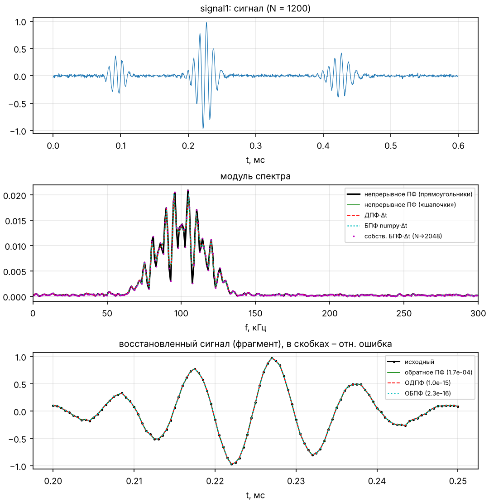
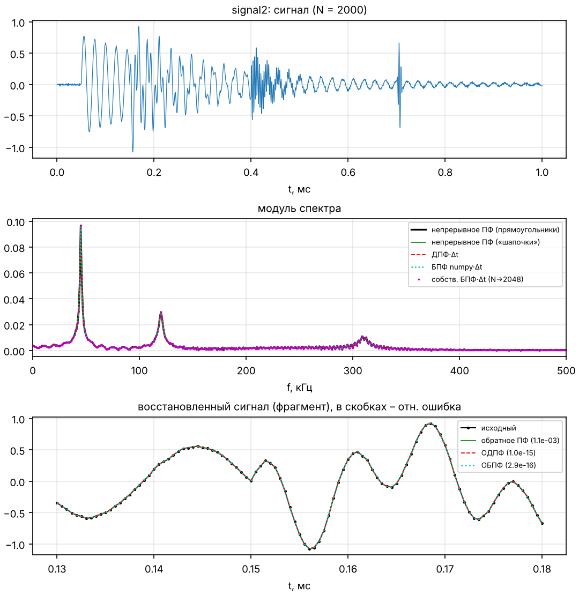
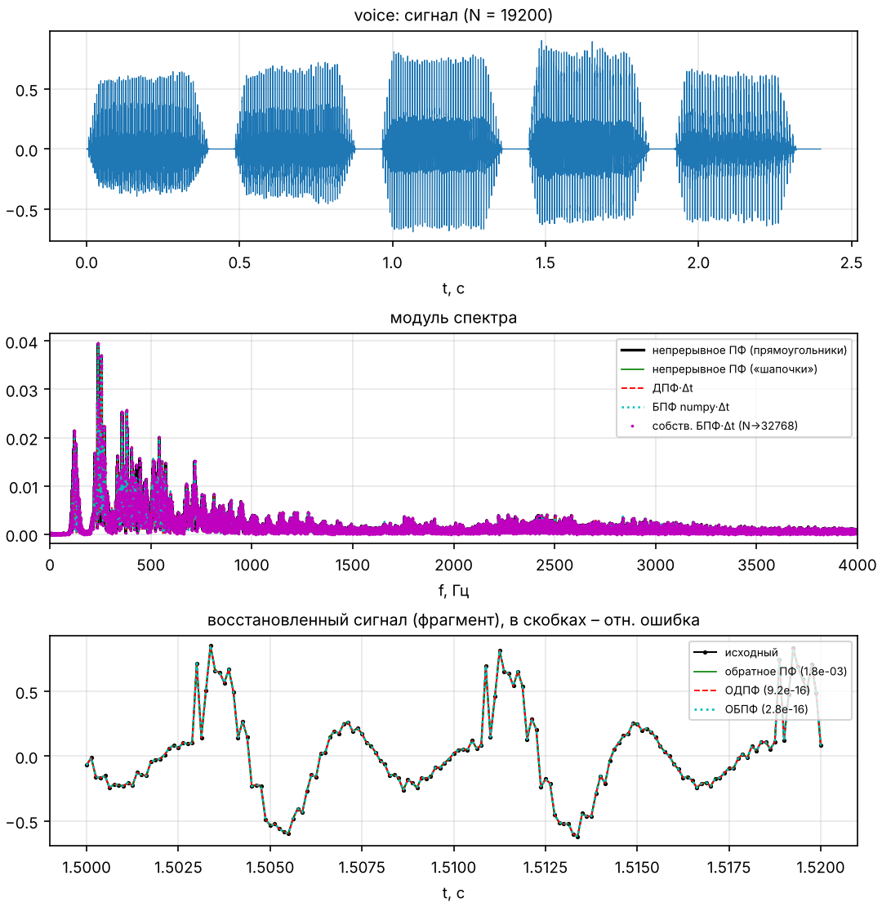
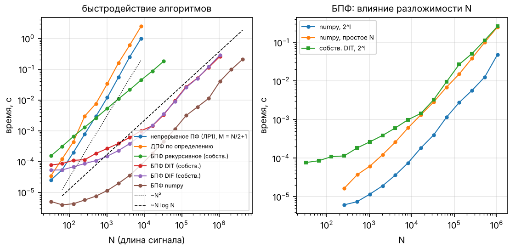
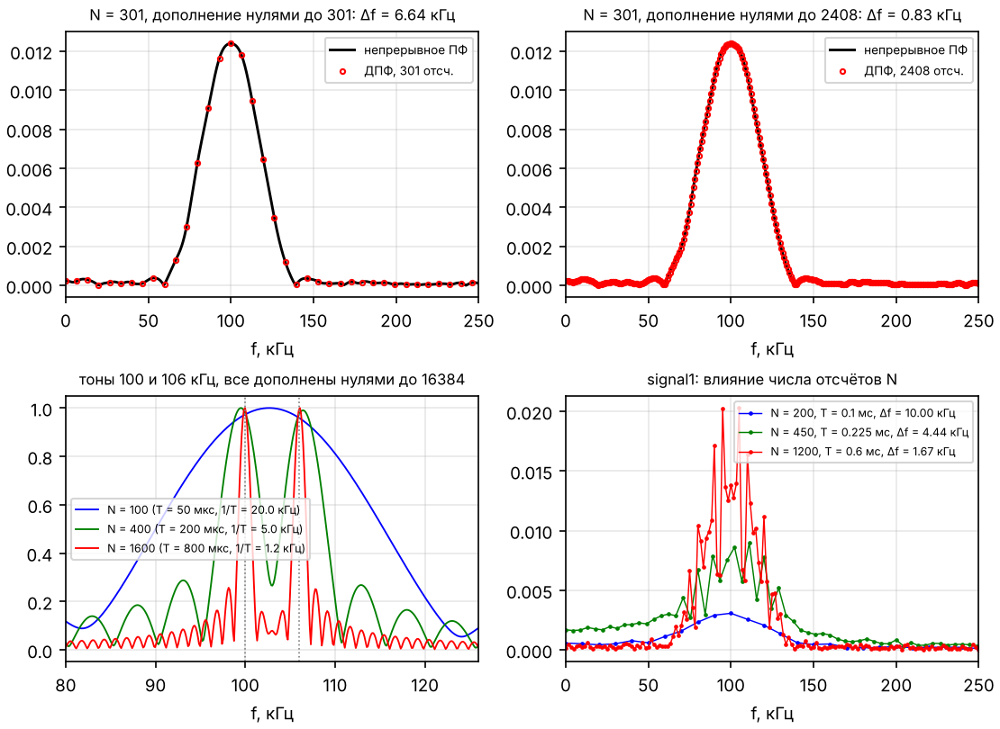

<!-- title: Дискретное преобразование Фурье и быстрое преобразование Фурье -->

# 1. Постановка задачи

Реализовать вычисление прямого и обратного дискретного преобразования Фурье (ДПФ), в том числе с
использованием алгоритмов быстрого преобразования Фурье (БПФ). Провести анализ:

* сопоставить результаты вычисления спектра сигнала с использованием реализаций из ЛР1 (непрерывное ПФ),
  ДПФ и алгоритмов БПФ;
* сравнить быстродействие всех подходов в зависимости от количества отсчётов;
* оценить, как влияют используемое количество отсчётов и добавление к сигналу отсчётов с нулевыми
  значениями на результаты применения ДПФ.

Входные данные — те же, что в ЛР1 (`data/signal1.txt`, `data/signal2.txt`, `data/voice.wav`,
`data/melody.wav`; описание — в отчёте по ЛР1).

# 2. Алгоритмы

**ДПФ** дискретного сигнала $p(n)$, $n=0..N-1$, $t_n=n\Delta t$:
$$P(k)=\sum_{n=0}^{N-1}p(n)e^{-i2\pi kn/N},\qquad p(n)=\frac1N\sum_{k=0}^{N-1}P(k)e^{i2\pi kn/N},$$
частоты $f_k=k\Delta f$, $\Delta f=1/(N\Delta t)$ (в формуле (2) Theory_Lab2 пропущен множитель $1/N$ — без него
восстановленный сигнал увеличен в $N$ раз). Связь с непрерывным ПФ (формула прямоугольников ЛР1):
$P(\omega_k)\approx\Delta t\cdot P(k)$, поэтому для сопоставления ДПФ умножается на $\Delta t$.
Реализация «по определению» — умножение на матрицу $e^{-i2\pi kn/N}$ (по блокам строк), $O(N^2)$
операций; показатель экспоненты вычисляется как $(kn \bmod N)$ для уменьшения ошибок округления.

{{code:lab2/lab2.py:dft}}

**БПФ** (лекции 2–3) при $N=2^l$ разбивает ДПФ длины $N$ на два ДПФ длины $N/2$, рекурсивно, что
даёт $\frac N2\log_2N$ умножений вместо $N^2$. Реализованы:

* рекурсивный алгоритм с прореживанием по времени (пояснение идеи):
  $X_k=E_k+W_N^kO_k$, $X_{k+N/2}=E_k-W_N^kO_k$, где $E$, $O$ — ДПФ чётных и нечётных отсчётов,
  $W_N=e^{-i2\pi/N}$;
* итеративный алгоритм с **прореживанием по времени** (Кули–Тьюки): бит-реверсная перестановка отсчётов
  и $\log_2N$ этапов «бабочек» $(a,b)\to(a+Wb,\;a-Wb)$;
* итеративный алгоритм с **прореживанием по частоте** (Сэнде–Тьюки): «бабочки» $(a,b)\to(a+b,\;(a-b)W)$
  и бит-реверсная перестановка результата;
* обратное БПФ через прямое — сопряжением спектра и результата: $p=\overline{\mathrm{FFT}(\overline P)}/N$.

Бабочки одного этапа вычисляются векторно (NumPy). Для $N\ne2^l$ сигнал дополняется нулями до
ближайшей степени двойки. Для сравнения используется библиотечная реализация `numpy.fft` (PocketFFT,
смешанные основания + алгоритм Блюстейна для простых $N$).

{{code:lab2/lab2.py:fft_dit}}

{{code:lab2/lab2.py:fft_dif}}

{{code:lab2/lab2.py:ifft_via_fft}}

{{code:lab2/lab2.py:fft_recursive}}

**Проверка.** На случайном сигнале $N=1024$ максимальное отличие от `numpy.fft.fft`: ДПФ —
{{res.check.dft:.1e}}, DIT — {{res.check.dit:.1e}}, DIF — {{res.check.dif:.1e}}, рекурсивное — {{res.check.rec:.1e}};
ошибка цикла «БПФ → обратное БПФ» — {{res.check.ifft:.1e}}.

# 3. Результаты

## 3.1. Сопоставление спектров и восстановленных сигналов

На рисунках 1–3 для трёх сигналов показаны: сигнал; модуль спектра, вычисленный непрерывным ПФ
(ЛР1, прямоугольники и «шапочки»), ДПФ, БПФ numpy и собственным БПФ (с дополнением нулями до $2^l$);
сигналы, восстановленные обратным непрерывным ПФ (ЛР1), обратным ДПФ и обратным БПФ.

{width=15.5cm}

{width=15.5cm}

{width=15.5cm}

Таблица 1 – Максимальные относительные расхождения спектров и ошибки восстановления

| сигнал | N | ДПФ·Δt vs непр. ПФ | numpy vs ДПФ | собств. БПФ vs непр. ПФ (сетка $2^l$) | обр. непр. ПФ | ОДПФ | ОБПФ |
|:-:|:-:|:-:|:-:|:-:|:-:|:-:|:-:|
| signal1 | {{res.compare.signal1.N}} | {{res.compare.signal1.dft_vs_cont:.0e}} | {{res.compare.signal1.np_vs_dft:.0e}} | {{res.compare.signal1.own_vs_cont:.0e}} | {{res.compare.signal1.err_cont:.1e}} | {{res.compare.signal1.err_idft:.0e}} | {{res.compare.signal1.err_ifft:.0e}} |
| signal2 | {{res.compare.signal2.N}} | {{res.compare.signal2.dft_vs_cont:.0e}} | {{res.compare.signal2.np_vs_dft:.0e}} | {{res.compare.signal2.own_vs_cont:.0e}} | {{res.compare.signal2.err_cont:.1e}} | {{res.compare.signal2.err_idft:.0e}} | {{res.compare.signal2.err_ifft:.0e}} |
| voice | {{res.compare.voice.N}} | {{res.compare.voice.dft_vs_cont:.0e}} | {{res.compare.voice.np_vs_dft:.0e}} | {{res.compare.voice.own_vs_cont:.0e}} | {{res.compare.voice.err_cont:.1e}} | {{res.compare.voice.err_idft:.0e}} | {{res.compare.voice.err_ifft:.0e}} |

Выводы из сопоставления:

* ДПФ, умноженное на $\Delta t$, **тождественно** формуле прямоугольников непрерывного ПФ на частотах
  $f_k=k/(N\Delta t)$ (расхождение — ошибки округления); БПФ — это тот же результат, вычисленный быстрее.
  Спектр, вычисленный «шапочками», отличается множителем $\mathrm{sinc}^2(\pi f\Delta t)$ (заметно лишь
  при приближении к $f_s/2$).
* Непрерывное ПФ (ЛР1) позволяет вычислять спектр на **произвольной** сетке частот, ДПФ — только на сетке
  с фиксированным шагом $\Delta f=1/(N\Delta t)$. Собственное БПФ с дополнением нулями до $2^l$ даёт
  значения на более частой сетке, которые совпадают с непрерывным ПФ на этой сетке.
* ОДПФ и ОБПФ восстанавливают сигнал точно (ошибка ~$10^{-15}$): ДПФ — взаимно-однозначное
  преобразование $N$ чисел в $N$ чисел. Обратное непрерывное ПФ (ЛР1) даёт ошибку $10^{-4}\ldots10^{-3}$
  из-за усечения частотного диапазона и квадратурной формулы.

## 3.2. Быстродействие

Время вычисления спектра (минимум из нескольких запусков) случайного сигнала длины $N=2^l$ показано
на рисунке 4 и в таблице 2 (миллисекунды). Для непрерывного ПФ число частот $M=N/2+1$.

{width=16.5cm}

Таблица 2 – Время вычисления спектра, мс

{{res.md_timing}}

* Непрерывное ПФ и ДПФ по определению имеют сложность $O(N^2)$ (наклон 2 в логарифмическом масштабе):
  при увеличении $N$ в 2 раза время растёт в 4 раза; при $N=8192$ — около секунды и более.
* Все БПФ имеют сложность $O(N\log N)$: собственная итеративная реализация обрабатывает $N=2^{20}$
  примерно за {{res.t_dit_max:.2f}} с, т.е. быстрее ДПФ на порядки (при $N=8192$ —
  в {{res.speedup_8192:.0f}} раз). Алгоритмы с прореживанием по времени и по частоте имеют одинаковую трудоёмкость.
* Рекурсивный вариант БПФ медленнее итеративного из-за накладных расходов интерпретатора Python на
  вызовы функций (их $\sim2N$), хотя асимптотика та же.
* Библиотечное БПФ (код на C) ещё в 5–15 раз быстрее собственной реализации.
* Правый график: при простом $N$ библиотечное БПФ (алгоритм Блюстейна) работает в несколько раз медленнее,
  чем при близком $N=2^l$, — БПФ наиболее эффективно, когда $N$ раскладывается на малые множители, особенно
  при $N=2^l$.

## 3.3. Влияние числа отсчётов и дополнения нулями

Результаты показаны на рисунке 5.

{width=16.5cm}

* **Дополнение нулями** (верхний ряд: фрагмент signal1 с пакетом $A_0$, $N={{res.zp.N}}$, дополнен до $8N$)
  уменьшает шаг по частоте $\Delta f=1/(L\Delta t)$, т.е. даёт значения спектра в промежуточных точках.
  Все они лежат на кривой непрерывного ПФ того же (недополненного) сигнала: дополнение нулями — это
  интерполяция спектра, новой информации о сигнале оно не добавляет. При этом восстановленный обратным
  ДПФ сигнал совпадает с исходным (ошибка {{res.zp.rec_err:.0e}}), а добавленные отсчёты остаются нулевыми.
* **Разрешающая способность** определяется длительностью сигнала $T=N\Delta t$, а не числом нулей
  (нижний левый график): два тона 100 и 106 кГц при $T=50$ мкс ($1/T=20$ кГц) сливаются в один пик даже
  после дополнения нулями до 16384 отсчётов; при $T=200$ мкс ($1/T=5$ кГц) пики различимы; при $T=800$ мкс —
  хорошо разделены. Пики имеют вид $\mathrm{sinc}$ шириной $\sim2/T$ с боковыми лепестками.
* **Число отсчётов** (нижний правый график, signal1 при $N=200, 450, 1200$): уменьшение $N$ (при том же $\Delta t$)
  сокращает временное окно — в спектр попадают не все волновые пакеты, и шаг $\Delta f$ становится грубее
  (13,3 → 1,7 кГц), сглаживая детали спектра. Дополнение нулями помогает при необходимости точнее
  определить положение пика, но не разделить близкие компоненты.
* Дополнение нулями до $2^l$ также используется для ускорения БПФ (п. 3.2).

# 4. Выводы

1. Реализованы ДПФ и обратное ДПФ по определению, собственные БПФ (рекурсивное, итеративные с
   прореживанием по времени и по частоте) и обратное БПФ через прямое; корректность подтверждена
   сравнением с `numpy.fft` (расхождения ~$10^{-14}$).
2. ДПФ·Δt совпадает с непрерывным ПФ по формуле прямоугольников на сетке $f_k=k/(N\Delta t)$; ОДПФ/ОБПФ
   восстанавливают сигнал с машинной точностью.
3. ДПФ имеет сложность $O(N^2)$, БПФ — $O(N\log N)$; при $N=8192$ собственное БПФ быстрее ДПФ в тысячи раз, а сигналы
   длиной $10^6$ обрабатываются за доли секунды. Наиболее эффективен случай $N=2^l$.
4. Дополнение нулями интерполирует спектр (уменьшает $\Delta f$), но не повышает разрешающую способность,
   которая определяется длительностью записи $T$.

Программа: `lab2/lab2.py` (запуск `python lab2/lab2.py [файлы сигналов]`).
