<!-- title: Применение простейших цифровых фильтров -->

# 1. Постановка задачи

Научиться применять простейшие фильтры к тестовым сигналам (ограничиваемся нерекурсивными фильтрами
с конечной импульсной характеристикой — КИХ-фильтрами). Конкретные задачи:

1. реализовать фильтр «скользящее среднее» (входной параметр — ширина фильтра в отсчётах);
   визуализировать сопоставление сглаженного и исходного сигналов и их спектров;
2. реализовать приближение идеального фильтра низких частот (ФНЧ) фильтрами Баттерворта, Чебышева
   первого рода и эллиптическим (входные параметры — частота среза $f_c$, порядок фильтра $n$); вывести
   частотную характеристику фильтра, сопоставление исходного и отфильтрованного сигналов и их спектров;
3. реализовать полосовую фильтрацию сигнала фильтром с косинусоидальным сглаживанием АЧХ
   (Сергиенко А.Б., формула 6.15); входные параметры — начальная и конечная частоты полосы.

**Входные данные** — те же, что в ЛР1, 2 (`data/`): `signal1` (волны Лэмба, 100 кГц; для
фильтра «скользящее среднее» к нему добавлен белый шум с СКО 0,15), `signal2` (компоненты 45, 120,
250, 310 кГц), `voice` (голос, 8 кГц, фрагмент 0,4 с — гласная «а»).

Выбран вариант реализации (а): все три фильтра запрограммированы самостоятельно (`lab3/lab3.py`);
из библиотеки SciPy используются только расчёт АЧХ аналогового эллиптического прототипа (нули/полюсы)
и, для сравнения, стандартные рекурсивные реализации фильтров.

# 2. Алгоритмы

## 2.1. Скользящее среднее

$$y_k=\frac1M\sum_{m=-(M-1)/2}^{(M-1)/2}x_{k+m}.$$
Это КИХ-фильтр с импульсной характеристикой $h_m=1/M$; он центрирован, поэтому не вносит задержки.
Сумма вычисляется через кумулятивную сумму ($O(N)$ операций независимо от $M$), края дополняются
крайними значениями. АЧХ фильтра
$$|H(f)|=\left|\frac{\sin(\pi fM\Delta t)}{M\sin(\pi f\Delta t)}\right|$$
имеет первый ноль на частоте $f_s/M$ и боковые лепестки, убывающие медленно (≈ −13 дБ).

{{code:lab3/lab3.py:moving_average}}

## 2.2. ФНЧ Баттерворта, Чебышева I рода, эллиптический

Квадраты АЧХ аналоговых фильтров-прототипов (лекция 4):

* Баттерворт: $|K(f)|^2=\dfrac{1}{1+(f/f_c)^{2n}}$ — максимально плоская АЧХ, на $f_c$ уровень −3 дБ;
* Чебышев I рода: $|K(f)|^2=\dfrac{1}{1+\varepsilon^2T_n^2(f/f_c)}$, $T_n$ — многочлен Чебышева,
  $\varepsilon^2=10^{R_p/10}-1$ — равноволновые пульсации в полосе пропускания ($R_p=1$ дБ),
  более крутой спад;
* эллиптический: $|K(f)|^2=\dfrac{1}{1+\varepsilon^2R_n^2(f/f_c)}$, $R_n$ — рациональная функция
  Чебышева (эллиптическая): пульсации и в полосе пропускания ($R_p=1$ дБ), и в полосе задерживания
  ($R_s=40$ дБ), самый крутой переход при данном порядке.

Поскольку рассматриваются КИХ-фильтры, заданная АЧХ $|K(f)|$ реализуется **методом частотной выборки
с весовым окном**: АЧХ (с нулевой фазой) задаётся на частой сетке, обратным БПФ вычисляется импульсная
характеристика, она сдвигается к центру, усекается до $L=255$ отсчётов и умножается на окно Хэмминга
(подавление эффекта Гиббса от усечения). Полученный фильтр симметричен, т.е. имеет линейную ФЧХ;
применяется центрированной свёрткой — без задержки и без фазовых искажений.

{{code:lab3/lab3.py:prototype_response}}

{{code:lab3/lab3.py:fir_from_response}}

Для сравнения использованы и классические рекурсивные (БИХ) реализации `scipy.signal.butter` и т.п.,
получаемые из аналогового прототипа билинейным преобразованием $p=\frac{2}{\Delta t}\frac{1-z^{-1}}{1+z^{-1}}$.

## 2.3. Полосовой фильтр с косинусоидальным сглаживанием АЧХ

АЧХ ФНЧ с косинусоидальным сглаживанием (6.15) и его импульсная характеристика (6.16):
$$K(\omega)=\begin{cases}1, & |\omega|\le\omega_0(1-\alpha),\\
\dfrac12-\dfrac12\sin\dfrac{\pi(|\omega|-\omega_0)}{2\alpha\omega_0}, & \omega_0(1-\alpha)<|\omega|\le\omega_0(1+\alpha),\\
0, & |\omega|>\omega_0(1+\alpha),\end{cases}\qquad
h(t)=\frac{\omega_0}{\pi}\,\frac{\sin\omega_0t}{\omega_0t}\,\frac{\cos\alpha\omega_0t}{1-(2\alpha\omega_0t/\pi)^2}.$$
Полосовой фильтр $[f_1,f_2]$ получается как разность двух ФНЧ:
$h_{bp}(t)=h(t;f_2,\alpha_2)-h(t;f_1,\alpha_1)$, $K_{bp}=K(f;f_2)-K(f;f_1)$, где
$\alpha_i=\Delta f_{пер}/f_i$ выбраны так, чтобы полуширина переходной зоны $\Delta f_{пер}$ (по умолчанию
$0{,}15(f_2-f_1)$) была одинаковой на обоих краях. Импульсная характеристика дискретизируется
$h_k=\Delta t\,h_{bp}(k\Delta t)$, $|k|\le(L-1)/2$; неопределённость $0/0$ в точках $\alpha\omega_0t=\pm\pi/2$
раскрывается по правилу Лопиталя: $h=\frac{\omega_0\alpha}{2\pi}\sin\frac{\pi}{2\alpha}$.
Так как АЧХ и её первая производная непрерывны, $h(t)$ убывает как $t^{-3}$, и усечение мало искажает АЧХ.

{{code:lab3/lab3.py:raised_cosine_lp_h}}

{{code:lab3/lab3.py:bandpass_raised_cosine}}

# 3. Результаты

## 3.1. Скользящее среднее

АЧХ фильтра для разных $M$ показана на рисунке 1. Фильтр подавляет высокочастотный шум, но не имеет
плоской полосы пропускания: уже при $M=11$ первый ноль АЧХ (182 кГц) близок к полосе сигнала
(60–140 кГц), и полезный сигнал ослабляется.

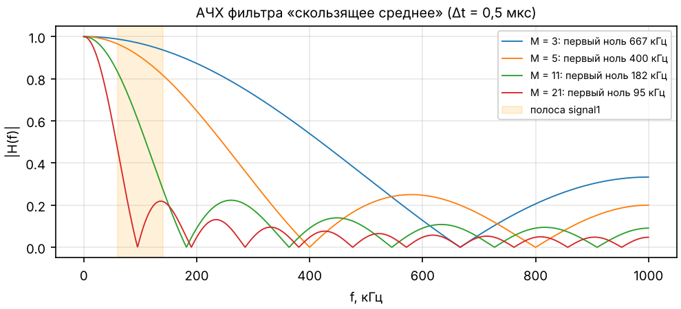{width=13cm}

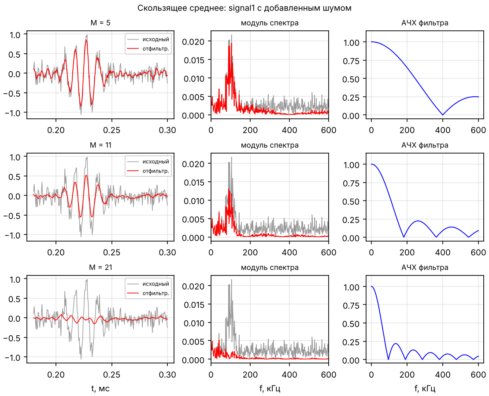{width=16.5cm}

Относительная ошибка $\|y-x_{чист}\|/\|x_{чист}\|$ (сравнение с сигналом без шума): у зашумлённого
сигнала {{res.ma_noisy:.2f}}; после сглаживания при $M=3$ — {{res.ma.3:.2f}}, $M=5$ — {{res.ma.5:.2f}},
$M=7$ — {{res.ma.7:.2f}} (оптимум), $M=11$ — {{res.ma.11:.2f}}, $M=21$ — {{res.ma.21:.2f}}.
Т.е. существует оптимальная ширина: малое $M$ плохо подавляет шум, большое — «съедает» сигнал
(при $M=21$ первый ноль АЧХ $f_s/M\approx95$ кГц попадает в центр полосы сигнала, рисунок 2).

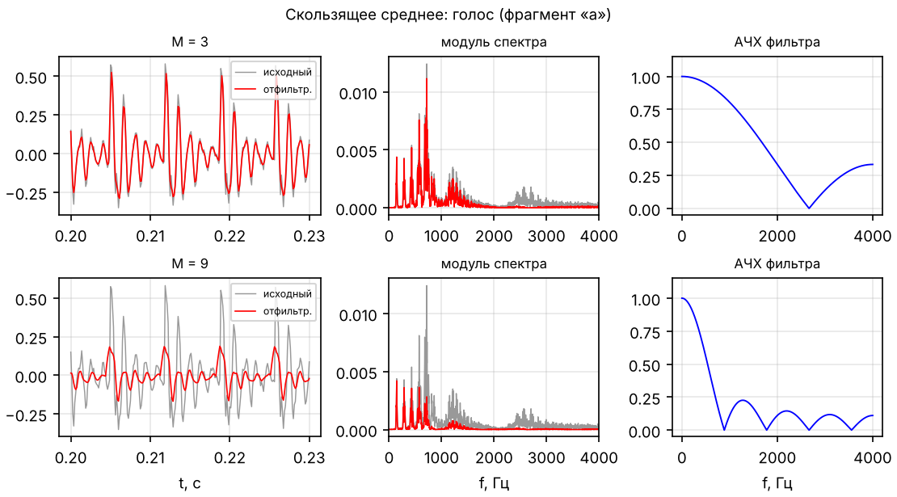{width=16.5cm}

Для голоса (рисунок 3) сглаживание с $M=3$ ослабляет верхние форманты (2,5 кГц и выше), при $M=9$ остаются
только гармоники ниже ≈ 900 Гц; форма периода основного тона становится гладкой.

## 3.2. ФНЧ

На рисунке 4 показаны АЧХ прототипов для $f_c=100$ кГц и $n=2,4,8$ в линейном и логарифмическом масштабе;
пунктиром — АЧХ реализованных КИХ-фильтров ($L=255$). КИХ-реализация повторяет прототип до уровня
≈ −60…−70 дБ (ниже начинает сказываться усечение импульсной характеристики и окно).

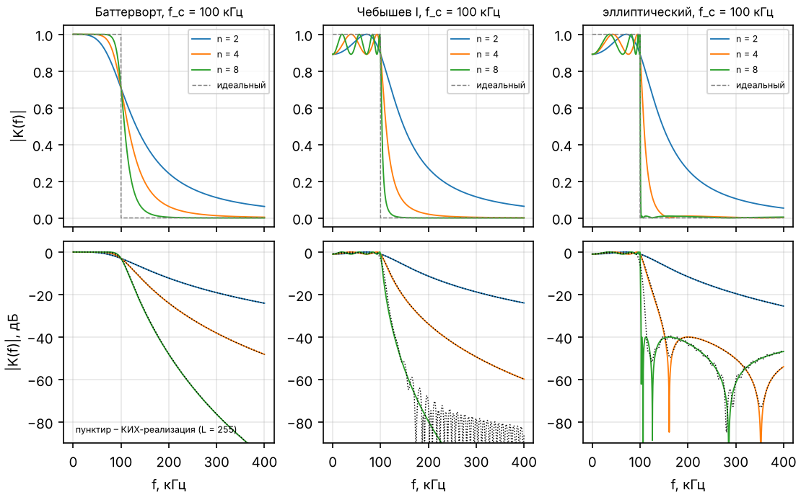{width=16.5cm}

Сравнение фильтров при одинаковом порядке ($n=6$, $f_c=80$ кГц, рисунок 5): все три пропускают
компоненту 45 кГц и подавляют 120, 250 и 310 кГц. Остаточная амплитуда пика 120 кГц относительно исходной:
Баттерворт — {{res.lpf.butter:.3f}}, Чебышев I — {{res.lpf.cheby1:.3f}}, эллиптический — {{res.lpf.ellip:.4f}}.
Плата за крутизну — пульсации АЧХ в полосе пропускания (Чебышев, эллиптический: амплитуда 45 кГц
меняется в пределах 1 дБ) и в полосе задерживания (эллиптический).

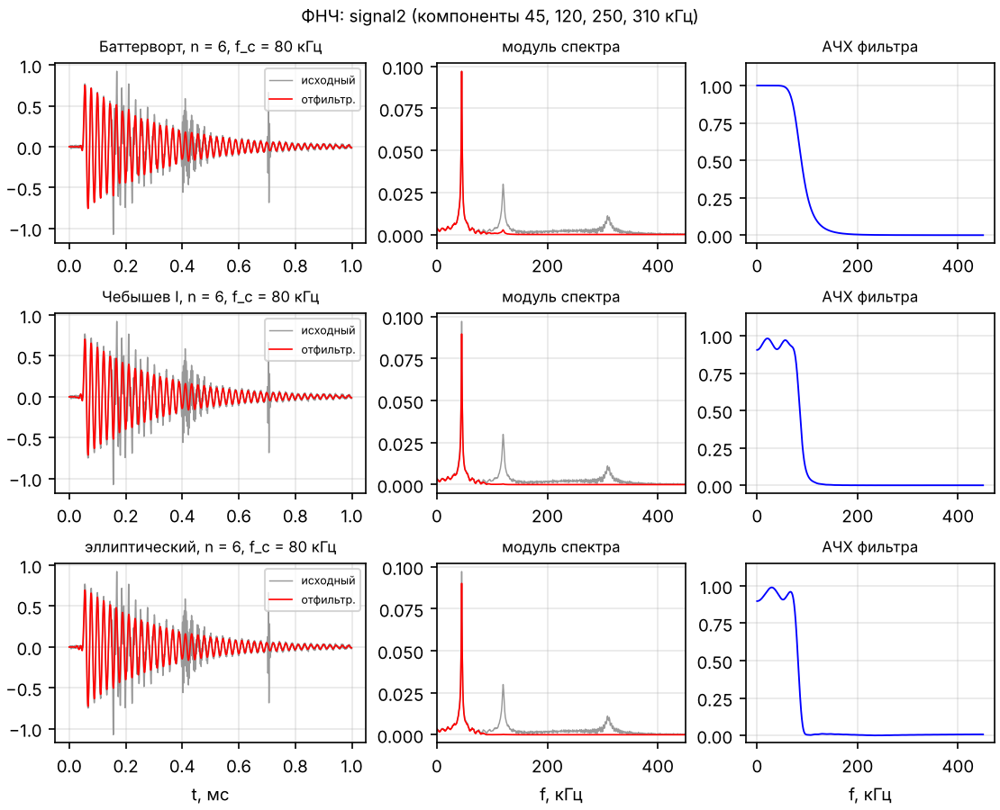{width=16.5cm}

Влияние частоты среза и порядка показано на рисунках 6 и 7. При $f_c=60$ кГц остаётся только компонента
45 кГц, при $f_c=180$ кГц добавляется 120 кГц, при $f_c=280$ кГц — практически весь сигнал, кроме 310 кГц.
С ростом порядка увеличивается крутизна спада АЧХ: при $n=1$ фильтр почти не подавляет 120 кГц, при $n=10$
переход очень резкий, но импульсная характеристика становится длиннее (на временной диаграмме —
«звон» на фронтах).

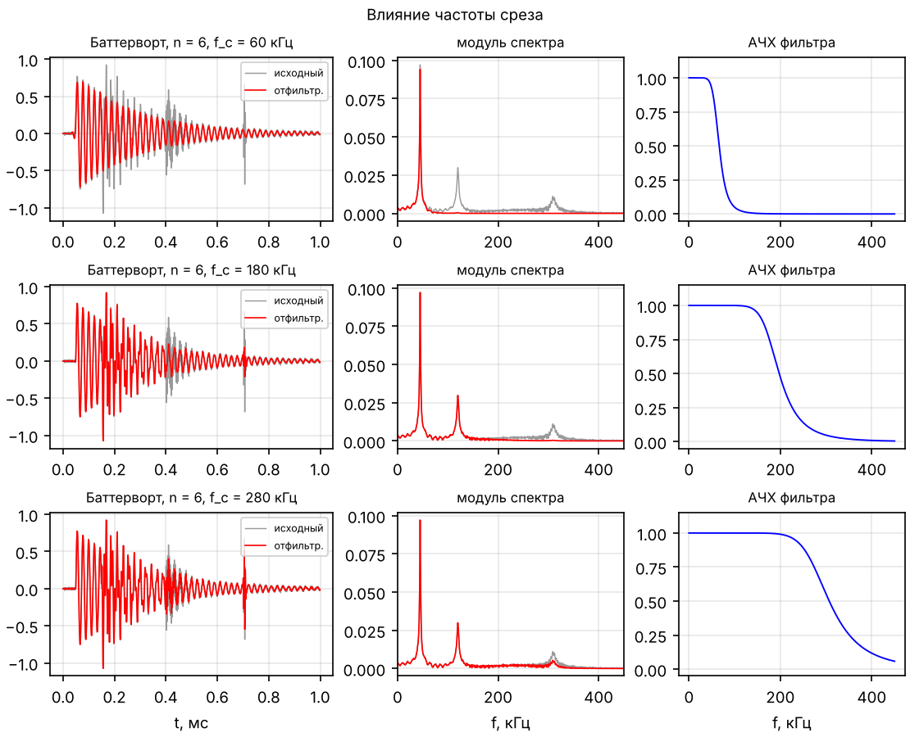{width=16.5cm}

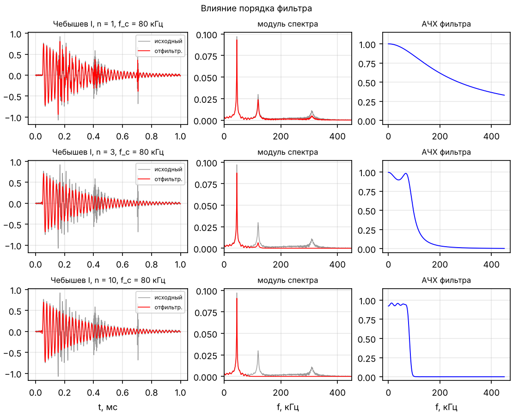{width=16.5cm}

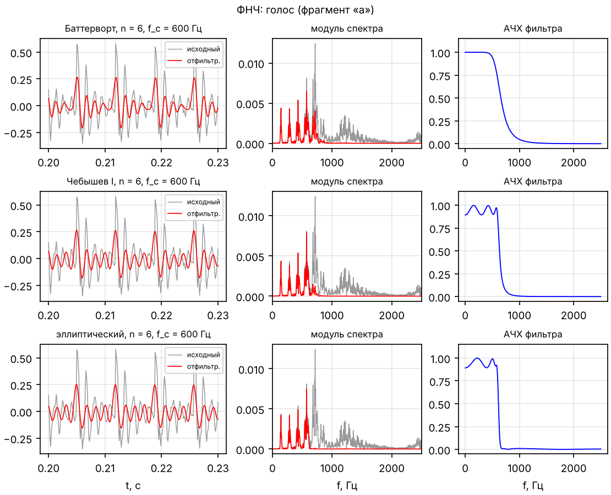{width=16.5cm}

**КИХ против БИХ (рисунок 9).** Рекурсивный фильтр Баттерворта той же АЧХ, применённый обычным образом
(`sosfilt`), задерживает сигнал (≈ {{res.iir_delay_us:.1f}} мкс) и искажает форму пакета, поскольку
групповая задержка зависит от частоты (нелинейная ФЧХ). КИХ-фильтр с симметричной импульсной
характеристикой задержки не вносит; тот же результат у БИХ даёт только двухпроходная фильтрация
(`sosfiltfilt`, вперёд и назад), неприменимая в реальном времени.

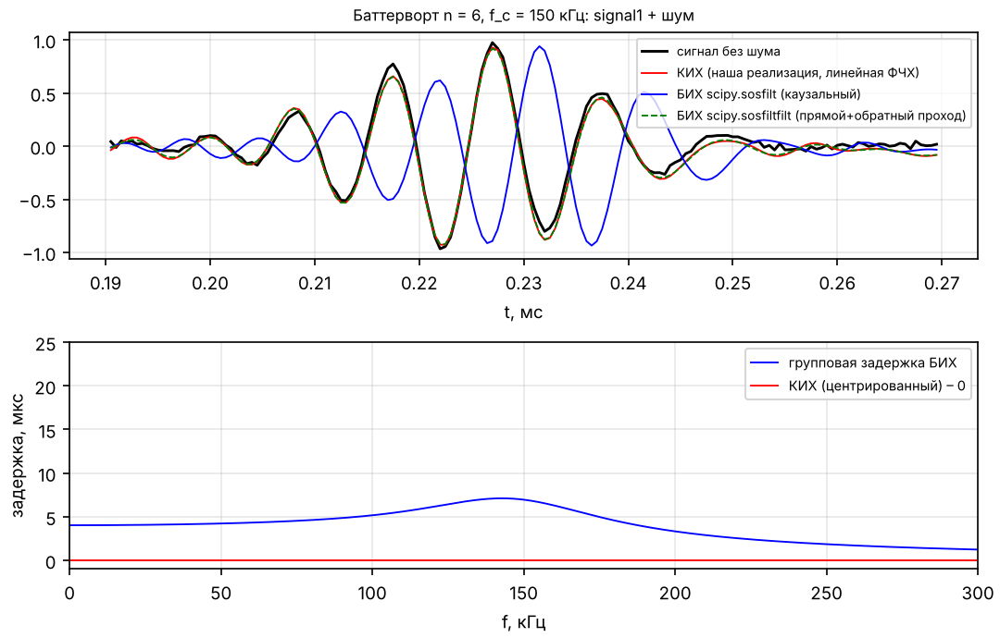{width=15cm}

## 3.3. Полосовой фильтр с косинусоидальным сглаживанием АЧХ

На рисунке 10 показаны: АЧХ полосового фильтра 100–140 кГц для разной длины $L$ (при $L=51$ импульсная
характеристика усечена слишком сильно — АЧХ сглажена, есть боковые лепестки; при $L=801$ АЧХ совпадает
с (6.15)); АЧХ в дБ для разной ширины переходной зоны (чем шире переходная зона, тем быстрее убывает
$h(t)$ и тем ниже уровень боковых лепестков); импульсная характеристика.

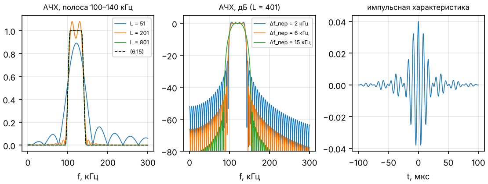{width=16.5cm}

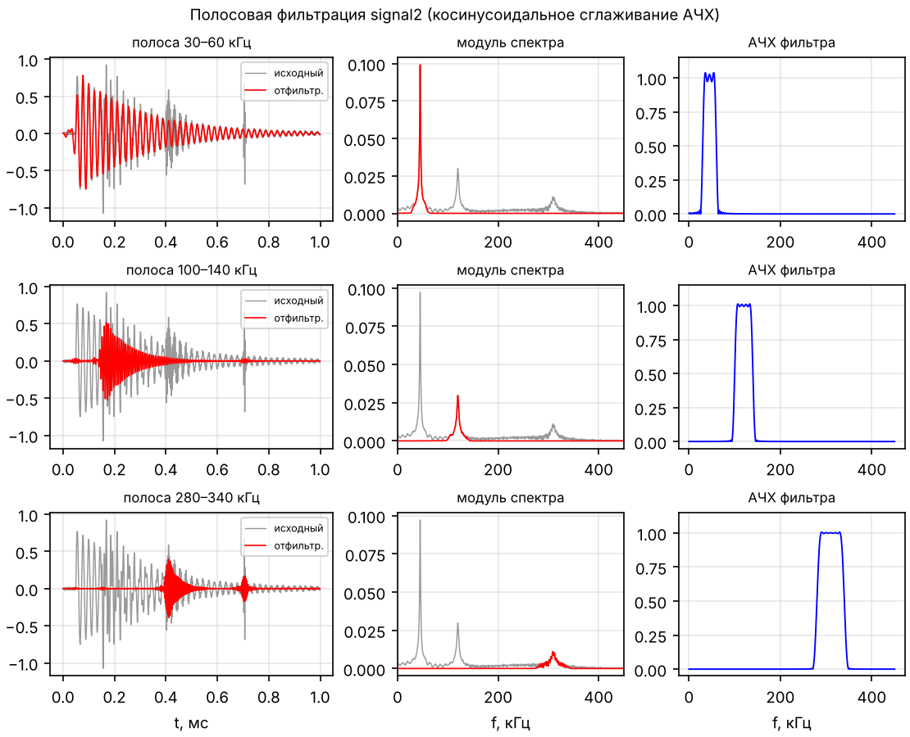{width=16.5cm}

Применение к `signal2` (рисунок 11) позволяет выделить отдельные компоненты: полоса 30–60 кГц — колебание
45 кГц, 100–140 кГц — затухающее колебание 120 кГц, 280–340 кГц — колебание 310 кГц, включающееся при
0,4 мс, и часть спектра короткого импульса 250 кГц (момент 0,7 мс). Неравномерность АЧХ в полосе
пропускания (вне переходных зон) не превышает 4 % ($L=401$). Для голоса (рисунок 12) полосовые фильтры
выделяют области основного тона/первых гармоник (100–400 Гц), первой форманты (500–900 Гц) и второй форманты
(1000–1600 Гц).

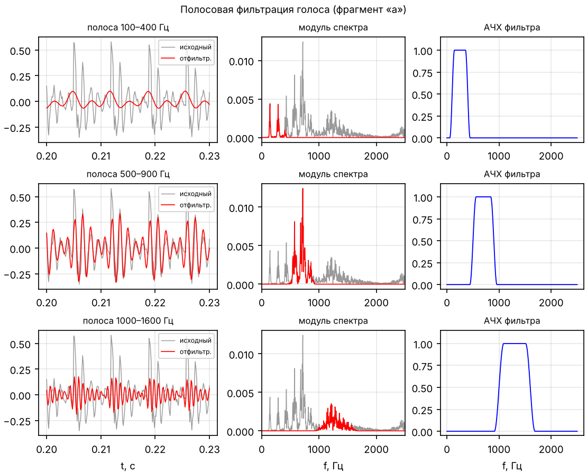{width=16.5cm}

# 4. Выводы

1. Скользящее среднее — простейший КИХ-ФНЧ; эффективно подавляет широкополосный шум, но его АЧХ
   не имеет плоской полосы пропускания и имеет высокие боковые лепестки, поэтому ширину $M$ следует
   выбирать так, чтобы $f_s/M$ было заметно выше полосы сигнала (для `signal1` оптимум $M\approx7$).
2. При одинаковом порядке крутизна спада АЧХ растёт в ряду Баттерворт → Чебышев I → эллиптический,
   за счёт пульсаций в полосе пропускания (Чебышев) и в полосе задерживания (эллиптический).
   Порядок фильтра определяет крутизну, частота среза — границу пропускаемых частот.
3. Реализация АЧХ прототипа КИХ-фильтром (частотная выборка + окно) даёт линейную ФЧХ и
   отсутствие задержки/фазовых искажений, в отличие от рекурсивной реализации.
4. Фильтр с косинусоидальным сглаживанием АЧХ имеет быстро убывающую импульсную характеристику
   ($\sim t^{-3}$), поэтому его КИХ-аппроксимация точна уже при умеренной длине; он позволяет выделять
   отдельные частотные компоненты сигнала.

Программа: `lab3/lab3.py` (запуск `python lab3/lab3.py [файлы сигналов]`).
